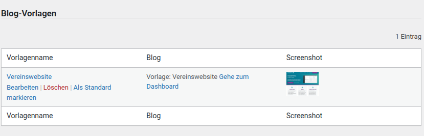

# New Blog Templates

[Deutsch](README.md) | **English**

**Create new websites without starting from scratch every time.**

With New Blog Templates, prepare a website once and then use it as the starting point for more websites in your network. For example, club sites, project blogs, or school websites can start with suitable pages, posts, and a consistent look and feel.

## What can you copy?

Choose which parts of each template new websites will receive:

- Settings, the active theme, and active plugins
- Posts and selected pages
- Categories, tags, and links
- Menus and uploaded files
- Optionally, users from the template website

You can also set a default template, organize templates into categories, and offer new users a selection during registration.

## What do you need?

- A WordPress or ClassicPress multisite network
- Super Administrator access to the **Network Admin**
- A separate website to prepare as a template

This plugin is not intended for a single WordPress or ClassicPress website without a network.

## Get started

1. Install the plugin and select **Network Activate** under **Plugins** in Network Admin.
2. Prepare a separate template website with the content and theme you want.
3. Go to **Blog Templates → Blog Templates**, name the template, and select the prepared website.
4. Create the template, choose what to copy, and click **Save Template**.
5. Go to **Sites → Add New**, choose your template, and create the new website.

**[Read the detailed guide with screenshots (currently in German) →](docs/README.md)**

## Good to know

- **A template is a starting point, not ongoing synchronization.** Changes to the template website apply to websites created later. Existing websites remain unchanged.
- **Use a separate template website.** The network's main website is not intended to be used as a template source.
- **Only copy content that should be shared.** Check comments, files, and users beforehand, too.
- **New websites keep their own address and title.**
- **The plugin is not a backup solution.** Create a backup before making major changes.

## Help and feedback

Find answers to frequently asked questions at the end of the [German guide](docs/README.md#häufige-fragen).

Report bugs or suggest improvements in the [GitHub support area](https://github.com/cp-psource/blogvorlagen/issues).

---

A plugin by [PSOURCE](https://github.com/cp-psource).
