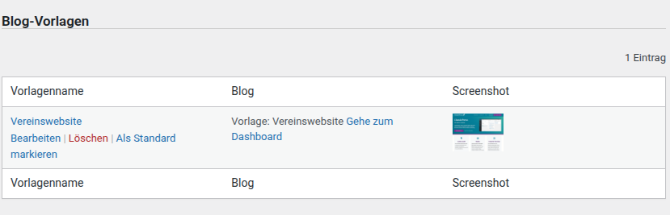

# Neue Blog-Vorlagen

**Neue Websites erstellen, ohne jedes Mal bei null anzufangen.**

Mit Neue Blog-Vorlagen bereitest Du eine Website einmal vor und verwendest sie anschließend als Ausgangspunkt für weitere Websites in Deinem Netzwerk. So starten zum Beispiel Vereinsseiten, Projektblogs oder Schulwebsites direkt mit passenden Seiten, Beiträgen und einem einheitlichen Erscheinungsbild.

## Was kannst Du übernehmen?

Du entscheidest für jede Vorlage, welche Bestandteile neue Websites erhalten:

- Einstellungen, das verwendete Theme und aktive Plugins
- Beiträge und ausgewählte Seiten
- Kategorien, Schlagwörter und Links
- Menüs und hochgeladene Dateien
- Auf Wunsch die Benutzer der Vorlagenwebsite

Zusätzlich kannst Du eine Standardvorlage festlegen, Vorlagen in Kategorien ordnen und neuen Benutzern bei der Registrierung eine Auswahl anbieten.

## Was brauchst Du?

- Ein WordPress- oder ClassicPress-Netzwerk mit mehreren Websites, auch „Multisite“ genannt
- Zugriff auf die **Netzwerkverwaltung** als Superadministrator
- Eine eigene Website, die Du als Vorlage vorbereitest

Das Plugin ist nicht für eine einzelne WordPress- oder ClassicPress-Website ohne Netzwerk gedacht.

## Dein schneller Einstieg

1. Installiere das Plugin und wähle in der Netzwerkverwaltung unter **Plugins** die Aktion **Netzwerkweit aktivieren**.
2. Bereite eine eigene Vorlagenwebsite mit den gewünschten Inhalten und dem passenden Theme vor.
3. Öffne **Blog-Vorlagen → Blog-Vorlagen**, gib der Vorlage einen Namen und wähle die vorbereitete Website aus.
4. Erstelle die Vorlage, lege fest, was übernommen werden soll, und klicke auf **Vorlage speichern**.
5. Öffne **Websites → Neu hinzufügen**, wähle Deine Vorlage und erstelle die neue Website.

**[Zur ausführlichen Anleitung mit Screenshots →](docs/README.md)**

## Gut zu wissen

- **Eine Vorlage ist ein Startpunkt, keine laufende Synchronisierung.** Änderungen an der Vorlagenwebsite gelten für später erstellte Websites. Bereits erstellte Websites bleiben unverändert.
- **Verwende eine eigene Vorlagenwebsite.** Die Hauptwebsite des Netzwerks ist nicht als Vorlagenquelle vorgesehen.
- **Übernimm nur Inhalte, die weitergegeben werden sollen.** Prüfe vorher auch Kommentare, Dateien und Benutzer.
- **Neue Websites behalten ihre eigene Adresse und ihren eigenen Titel.**
- **Das Plugin ersetzt keine Sicherung.** Lege vor größeren Änderungen ein Backup an.

## Hilfe und Rückmeldungen

Antworten auf häufige Fragen findest Du am Ende der [Anleitung](docs/README.md#häufige-fragen).

Fehler oder Verbesserungsvorschläge kannst Du im [Supportbereich auf GitHub](https://github.com/cp-psource/blogvorlagen/issues) melden.

---

Ein Plugin von [PSOURCE](https://github.com/cp-psource).
