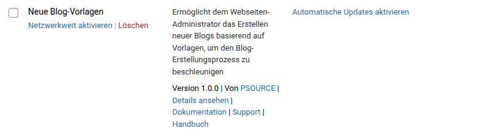
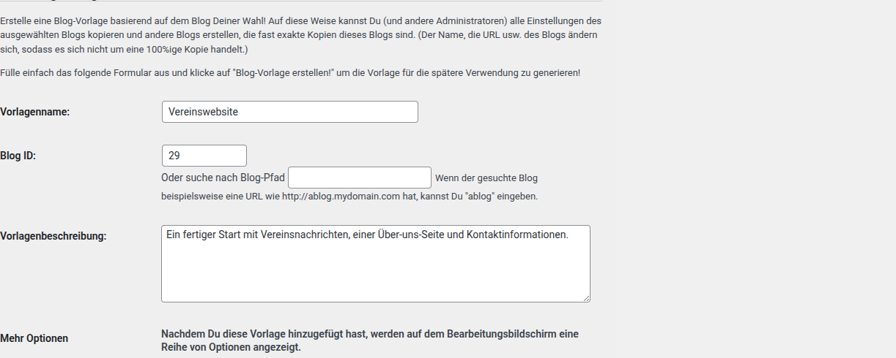
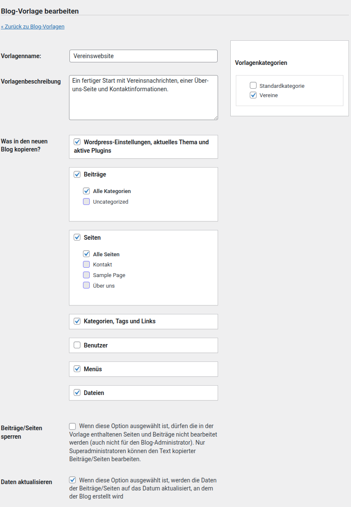
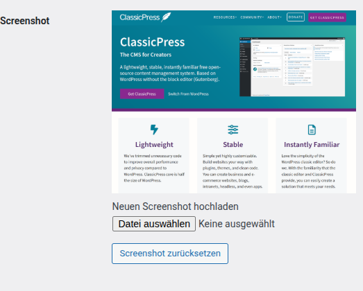
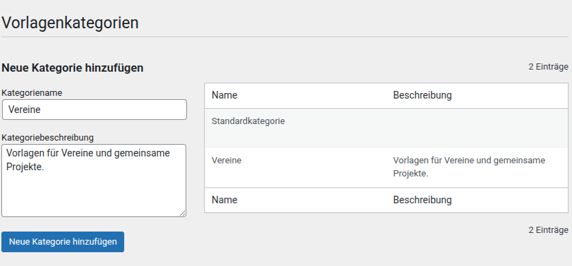
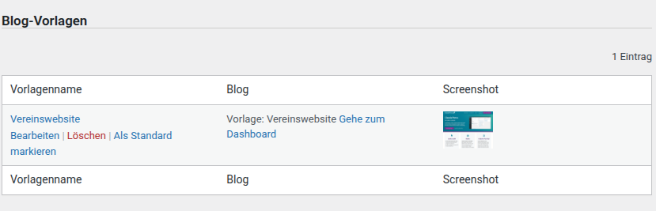
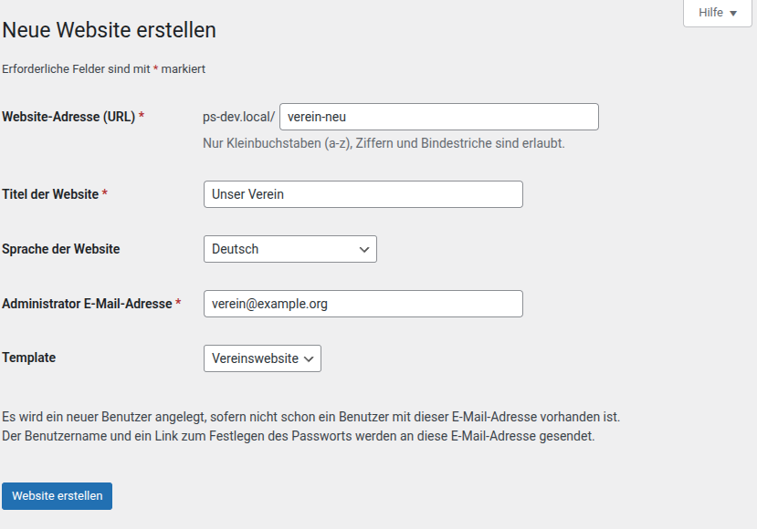
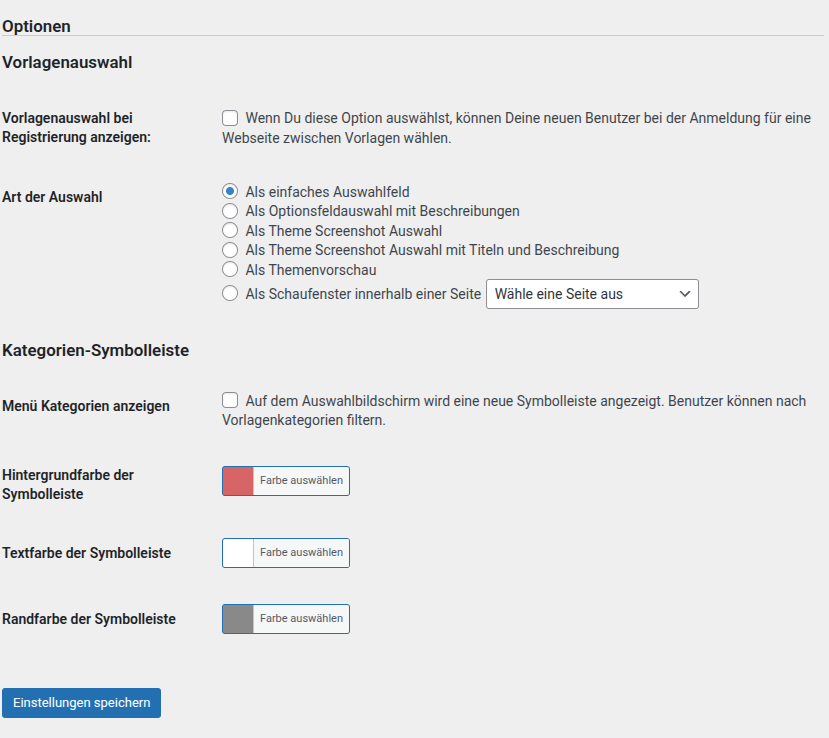

# Neue Blog-Vorlagen – Anleitung

Mit dieser Anleitung richtest Du eine Vorlagenwebsite ein und erstellst daraus neue Websites. Als Beispiel verwenden wir eine **Vereinswebsite** mit Nachrichten, einer Über-uns-Seite und einer Kontaktseite.

Die Screenshots zeigen die Oberfläche in ClassicPress. In WordPress oder einer anderen Sprache können einzelne Beschriftungen abweichen. „Websites“ kann beispielsweise „Sites“ heißen.

## Inhalt

1. [Plugin aktivieren](#1-plugin-aktivieren)
2. [Vorlagenwebsite vorbereiten](#2-vorlagenwebsite-vorbereiten)
3. [Eine Blog-Vorlage anlegen](#3-eine-blog-vorlage-anlegen)
4. [Festlegen, was übernommen wird](#4-festlegen-was-übernommen-wird)
5. [Ein Vorschaubild hinterlegen](#5-ein-vorschaubild-hinterlegen)
6. [Vorlagen mit Kategorien ordnen](#6-vorlagen-mit-kategorien-ordnen)
7. [Eine Standardvorlage festlegen](#7-eine-standardvorlage-festlegen)
8. [Eine neue Website aus der Vorlage erstellen](#8-eine-neue-website-aus-der-vorlage-erstellen)
9. [Vorlagen bei der Registrierung anbieten](#9-vorlagen-bei-der-registrierung-anbieten)
10. [Vorlagen pflegen und entfernen](#10-vorlagen-pflegen-und-entfernen)
11. [Häufige Fragen](#häufige-fragen)
12. [Diese Anleitung ins Wiki übernehmen](#diese-anleitung-ins-wiki-übernehmen)

## 1. Plugin aktivieren

Du benötigst ein WordPress- oder ClassicPress-Netzwerk mit mehreren Websites und Zugriff auf die **Netzwerkverwaltung** als Superadministrator.

1. Öffne die **Netzwerkverwaltung**.
2. Gehe zu **Plugins**.
3. Suche **Neue Blog-Vorlagen**.
4. Klicke auf **Netzwerkweit aktivieren**.

*Abbildung 1: Das Plugin wird für das gesamte Netzwerk aktiviert.*

Anschließend findest Du in der Netzwerkverwaltung das Menü **Blog-Vorlagen** mit den Unterpunkten **Blog-Vorlagen**, **Vorlagenkategorien** und **Einstellungen**.

> Wenn Du nur das Dashboard einer einzelnen Website siehst, wechsle zuerst in die Netzwerkverwaltung.

## 2. Vorlagenwebsite vorbereiten

Eine Vorlage basiert auf einer echten Website innerhalb Deines Netzwerks. Richte dafür am besten eine eigene Website ein, die ausschließlich als Ausgangspunkt für neue Websites dient.

1. Gehe zu **Websites → Neu hinzufügen**.
2. Erstelle eine eigene Website, zum Beispiel „Vereinsvorlage“. Wähle dabei noch keine Vorlage aus, falls die Vorlagenauswahl bereits angezeigt wird.
3. Öffne das Dashboard dieser Website.
4. Richte das gewünschte Theme und die benötigten Plugins ein.
5. Erstelle die Seiten, Beiträge, Menüs und Dateien, die neue Websites übernehmen sollen.
6. Entferne überflüssige Beispielinhalte.

Für unser Beispiel reichen zunächst:

- Ein Beitrag „Willkommen in unserem Verein“
- Eine Seite „Über uns“
- Eine Seite „Kontakt“
- Das gewünschte Erscheinungsbild und ein passendes Menü

> **Wichtig:** Verwende nicht die Hauptwebsite des Netzwerks als Quelle. Prüfe außerdem, dass die Vorlagenwebsite keine privaten Beiträge, Kommentare, Dateien oder Benutzer enthält, die versehentlich übernommen werden könnten.

Die Vorlagenwebsite bleibt später bearbeitbar. Du musst sie nicht jedes Mal neu anlegen.

## 3. Eine Blog-Vorlage anlegen

Wechsle zurück in die **Netzwerkverwaltung → Blog-Vorlagen → Blog-Vorlagen**. Unter der Vorlagenübersicht findest Du das Formular zum Erstellen einer neuen Vorlage.

*Abbildung 2: Name, Quelle und Beschreibung der Vorlage festlegen. Die Blog-ID im Screenshot ist nur ein Beispiel.*

1. **Vorlagenname:** Gib einen verständlichen Namen ein, zum Beispiel „Vereinswebsite“. Diesen Namen sehen Benutzer später in der Auswahl.
2. **Blog ID:** Wähle die vorbereitete Website:
   - Gib ihre Blog-ID ein, wenn Du sie kennst, **oder**
   - verwende **Oder suche nach Blog-Pfad**. Gib mindestens zwei Zeichen aus dem Adressbestandteil der Website ein und wähle einen Treffer aus.
3. **Vorlagenbeschreibung:** Erkläre kurz, für wen die Vorlage gedacht ist und welche Inhalte sie mitbringt.
4. Klicke unten auf **Erstelle eine Blog-Vorlage!**

**Beispielbeschreibung:**

> Ein fertiger Start mit Vereinsnachrichten, einer Über-uns-Seite und Kontaktinformationen.

Danach öffnet sich die Bearbeitungsansicht. Dort legst Du fest, welche Bestandteile übernommen werden.

## 4. Festlegen, was übernommen wird

In der Bearbeitungsansicht findest Du den Bereich **Was in den neuen Blog kopieren?**

*Abbildung 3: Die Beispielvorlage übernimmt Inhalte und Gestaltung, aber keine zusätzlichen Benutzer.*

### Die Auswahlmöglichkeiten

| Auswahl | Was sie bedeutet |
| --- | --- |
| **Wordpress-Einstellungen, aktuelles Thema und aktive Plugins** | Übernimmt die Einstellungen der Quelle sowie das ausgewählte Theme und die dort aktiven Plugins. Die neue Website behält ihre eigene Adresse und ihren eigenen Titel. |
| **Beiträge** | Übernimmt Beiträge. Du kannst alle Beitragskategorien oder bestimmte Kategorien auswählen. Zugehörige Kommentare werden ebenfalls übernommen. |
| **Seiten** | Übernimmt alle Seiten oder nur die von Dir ausgewählten Seiten. Zugehörige Kommentare werden ebenfalls übernommen. |
| **Kategorien, Tags und Links** | Übernimmt die Ordnung der Inhalte, etwa Kategorien und Schlagwörter. |
| **Benutzer** | Fügt die Benutzer der Vorlagenwebsite auch der neuen Website hinzu. Aktiviere dies nur, wenn diese Personen dort ebenfalls Zugriff erhalten sollen. |
| **Menüs** | Übernimmt die angelegten Navigationsmenüs. |
| **Dateien** | Übernimmt hochgeladene Dateien, beispielsweise Bilder und Dokumente. |

**Empfehlung für einen vollständigen Website-Start:** Wähle Einstellungen, Beiträge beziehungsweise Seiten, Kategorien, Menüs und Dateien. Lass **Benutzer** zunächst ausgeschaltet, wenn neue Websites ihre eigene Benutzerverwaltung erhalten sollen.

Wenn Du bei **Beiträge** oder **Seiten** nur bestimmte Inhalte übernehmen möchtest, entferne zuerst das Häkchen bei **Alle Kategorien** beziehungsweise **Alle Seiten**. Danach kannst Du einzelne Einträge auswählen.

> Bilder und Dokumente gehören zur Auswahl **Dateien**. Wenn Deine Beiträge, Seiten oder Gestaltung solche Dateien verwenden, solltest Du diese Option ebenfalls aktivieren.

### Beiträge und Seiten sperren

Mit **Beiträge/Seiten sperren** verhinderst Du, dass die übernommenen Inhalte von den Administratoren der einzelnen Websites bearbeitet werden. Nur Superadministratoren können sie weiterhin bearbeiten.

Das ist beispielsweise für verbindliche Hinweise sinnvoll. Lass die Option ausgeschaltet, wenn neue Website-Betreiber die übernommenen Texte selbst anpassen sollen.

### Daten aktualisieren

Mit **Daten aktualisieren** erhalten übernommene veröffentlichte Beiträge und Seiten das Datum der Erstellung der neuen Website. Gemeint sind die Datumsangaben, nicht eine spätere automatische Aktualisierung der Inhalte.

### Erweiterte Optionen

Der Bereich **Zusätzliche Tabellen** ist nur für besondere Plugin-Inhalte gedacht. Lass diese Auswahl unverändert, wenn Du nicht sicher weißt, dass sie für eines Deiner Plugins benötigt wird. Die Auswahl aktiver Plugins allein garantiert nicht, dass sämtliche besonderen Inhalte anderer Plugins mitkommen.

### Änderungen speichern

Klicke nach Deiner Auswahl unten auf **Vorlage speichern**.

## 5. Ein Vorschaubild hinterlegen

Ein passendes Bild hilft Benutzern, Vorlagen voneinander zu unterscheiden.

*Abbildung 4: Ein eigenes Vorschaubild auswählen oder zum vorhandenen Theme-Bild zurückkehren.*

1. Öffne die Vorlage über **Bearbeiten**.
2. Scrolle zum Bereich **Screenshot**.
3. Klicke bei **Neuen Screenshot hochladen** auf **Datei auswählen**.
4. Wähle ein Bild, das die Vorlagenwebsite gut zeigt.
5. Klicke auf **Vorlage speichern**.

Ohne eigenes Bild verwendet das Plugin das Vorschaubild des Themes. Mit **Screenshot zurücksetzen** entfernst Du Dein eigenes Vorschaubild und kehrst zu diesem Theme-Bild zurück.

**Tipp:** Verwende ein übersichtliches Bild ohne persönliche Daten. Ein Vorschaubild ist besonders hilfreich, wenn Du später eine bildbasierte Vorlagenauswahl anbietest.

## 6. Vorlagen mit Kategorien ordnen

Wenn Du mehrere Vorlagen anbietest, helfen Kategorien wie „Vereine“, „Projekte“ oder „Schulen“ bei der Auswahl.

*Abbildung 5: Vorlagenkategorien anlegen und verwalten.*

1. Öffne **Blog-Vorlagen → Vorlagenkategorien**.
2. Gib einen **Kategorienamen** ein.
3. Ergänze bei Bedarf eine **Kategoriebeschreibung**.
4. Klicke auf **Neue Kategorie hinzufügen**.
5. Öffne anschließend Deine Vorlage über **Bearbeiten**.
6. Wähle rechts im Bereich **Vorlagenkategorien** die passende Kategorie.
7. Klicke auf **Vorlage speichern**.

> Vorlagenkategorien ordnen Deine **Vorlagen**. Sie sind nicht dasselbe wie die Beitragskategorien innerhalb einer Website.

Wie Du die Kategorien auch für Benutzer in der Vorlagenauswahl sichtbar machst, beschreibt [Abschnitt 9](#9-vorlagen-bei-der-registrierung-anbieten).

## 7. Eine Standardvorlage festlegen

Eine Standardvorlage ist hilfreich, wenn neue Websites normalerweise mit demselben Grundaufbau starten sollen.

*Abbildung 6: Die Aktionen erscheinen unter dem Vorlagennamen, wenn Du mit der Maus darüberfährst.*

1. Öffne **Blog-Vorlagen → Blog-Vorlagen**.
2. Bewege die Maus über die gewünschte Vorlage.
3. Klicke auf **Als Standard markieren**.

Die Vorlage ist anschließend mit **(Standard)** gekennzeichnet. Sie wird verwendet, wenn keine andere Vorlage gewählt und nicht ausdrücklich auf eine Vorlage verzichtet wird.

Mit **Standard entfernen** hebst Du diese Festlegung wieder auf.

> Das Festlegen oder Entfernen einer Standardvorlage verändert keine bereits bestehenden Websites.

## 8. Eine neue Website aus der Vorlage erstellen

Jetzt kannst Du die vorbereitete Vorlage verwenden.

*Abbildung 7: Die Vorlage im Feld Template auswählen. Adresse und E-Mail-Adresse sind Beispielangaben.*

1. Öffne in der Netzwerkverwaltung **Websites → Neu hinzufügen**.
2. Gib die gewünschte **Website-Adresse** ein.
3. Ergänze den **Titel der Website** und gegebenenfalls die Sprache.
4. Trage die **Administrator-E-Mail-Adresse** für die neue Website ein.
5. Wähle im Feld **Template** Deine Vorlage, zum Beispiel „Vereinswebsite“.
6. Klicke auf **Website erstellen**. In WordPress kann die Schaltfläche anders beschriftet sein, beispielsweise **Website hinzufügen**.

Das Plugin übernimmt die ausgewählten Bestandteile. Öffne danach das Dashboard der neuen Website und prüfe:

- Sind die gewünschten Beiträge und Seiten vorhanden?
- Werden Bilder und Dokumente angezeigt?
- Stimmen Menüs und Gestaltung?
- Haben nur die vorgesehenen Benutzer Zugriff?
- Müssen Kontaktinformationen, Links oder andere Beispieltexte angepasst werden?

Die neue Website kann anschließend unabhängig von der Vorlagenwebsite weiterbearbeitet werden.

**Ohne Vorlage starten:** Wähle im Feld **Template** den Eintrag **None** beziehungsweise den entsprechenden Eintrag für „keine Vorlage“. Das ist auch möglich, wenn eine Standardvorlage festgelegt ist.

## 9. Vorlagen bei der Registrierung anbieten

Wenn Benutzer in Deinem Netzwerk selbst neue Websites registrieren dürfen, kannst Du ihnen eine Vorlagenauswahl anbieten.

*Abbildung 8: Die Vorlagenauswahl einschalten und ihre Darstellung wählen.*

1. Öffne **Blog-Vorlagen → Einstellungen**.
2. Aktiviere **Vorlagenauswahl bei Registrierung anzeigen**.
3. Wähle unter **Art der Auswahl** die gewünschte Darstellung.
4. Klicke auf **Einstellungen speichern**.

### Welche Darstellung passt zu Deinem Angebot?

| Darstellung | Geeignet, wenn … |
| --- | --- |
| **Als einfaches Auswahlfeld** | Du eine kompakte Liste mit Vorlagennamen möchtest. |
| **Als Optionsfeldauswahl mit Beschreibungen** | Benutzer die Vorlagen anhand kurzer Erklärungen vergleichen sollen. |
| **Als Theme Screenshot Auswahl** | Die Vorschaubilder im Mittelpunkt stehen sollen. |
| **Als Theme Screenshot Auswahl mit Titeln und Beschreibung** | Du Bilder und erklärende Texte gemeinsam zeigen möchtest. |
| **Als Themenvorschau** | Benutzer vor der Auswahl einen Eindruck von der Vorlagenwebsite bekommen sollen. |
| **Als Schaufenster innerhalb einer Seite** | Du die Vorlagen auf einer ausgewählten Seite der Hauptwebsite präsentieren möchtest. Wähle dafür die gewünschte Seite aus. |

Je nach Darstellung erscheinen weitere Optionen, etwa für Schaltflächentexte oder Farben.

### Kategorien als Filter anbieten

Wenn Du Vorlagenkategorien angelegt hast:

1. Aktiviere unter **Kategorien-Symbolleiste** die Option **Menü Kategorien anzeigen**.
2. Passe bei Bedarf Hintergrund-, Text- und Randfarbe an.
3. Klicke auf **Einstellungen speichern**.

Benutzer können die angebotenen Vorlagen dann nach Kategorien filtern.

> Das Einschalten der Vorlagenauswahl öffnet nicht automatisch die Registrierung Deines Netzwerks. Die Registrierung neuer Websites muss in den Netzwerkeinstellungen erlaubt sein. Die Darstellung kann außerdem vom verwendeten Theme abhängen.

## 10. Vorlagen pflegen und entfernen

### Inhalte und Gestaltung aktualisieren

Öffne das Dashboard der **Vorlagenwebsite** und ändere dort Beiträge, Seiten, Dateien oder Gestaltung. Diese Änderungen stehen Websites zur Verfügung, die anschließend aus der Vorlage erstellt werden.

Du musst dafür keine neue Blog-Vorlage anlegen.

### Die Auswahl ändern

Öffne **Blog-Vorlagen → Blog-Vorlagen → Bearbeiten**, passe die Auswahl der übernommenen Bestandteile an und klicke auf **Vorlage speichern**.

### Eine Vorlage entfernen

Klicke in der Vorlagenübersicht unter dem Namen auf **Löschen**. Damit entfernst Du die Vorlage aus dem Angebot.

Die zugrunde liegende Vorlagenwebsite und bereits daraus erstellte Websites bleiben bestehen. Wenn Du auch die Vorlagenwebsite nicht mehr benötigst, verwalte sie getrennt unter **Websites**.

> **Keine automatische Synchronisierung:** Änderungen an einer Vorlage aktualisieren bereits erstellte Websites nicht. Passe bestehende Websites bei Bedarf direkt an.

## Häufige Fragen

### Warum sehe ich das Menü Blog-Vorlagen nicht?

Prüfe, ob Du in der **Netzwerkverwaltung** angemeldet bist und das Plugin **netzwerkweit aktiviert** ist. Die Verwaltung der Vorlagen ist für Superadministratoren vorgesehen.

### Warum finde ich meine Website nicht über die Suche?

Die Suche verwendet den **Adressbestandteil der Website**, nicht ihren Titel. Bei einer Adresse wie `https://beispiel.de/vereinsvorlage/` kannst Du etwa `verein` eingeben. Wähle anschließend einen Treffer aus. Alternativ kannst Du die Blog-ID direkt eintragen.

### Warum fehlen Bilder auf der neuen Website?

Prüfe, ob in der Vorlage **Dateien** ausgewählt ist und die Bilder auf der Vorlagenwebsite selbst funktionieren. Bilder von anderen Websites werden nicht als eigene Dateien übernommen.

### Warum fehlen einzelne Seiten?

Prüfe in der Vorlage die Auswahl unter **Seiten**. Aktiviere entweder **Alle Seiten** oder die gewünschten einzelnen Seiten. Speichere die Vorlage, bevor Du die nächste Website erstellst.

### Warum kann ein Website-Administrator die übernommenen Texte nicht bearbeiten?

Wahrscheinlich ist **Beiträge/Seiten sperren** aktiviert. Entscheide vor dem Erstellen neuer Websites, ob ihre Betreiber die Texte selbst ändern dürfen. Ein späteres Ausschalten dieser Option entsperrt bereits erstellte Websites nicht automatisch.

### Warum erscheint bei der Registrierung keine Vorlagenauswahl?

Prüfe, ob **Vorlagenauswahl bei Registrierung anzeigen** aktiviert und gespeichert ist, ob Vorlagen vorhanden sind und ob Dein Netzwerk die Registrierung neuer Websites erlaubt.

### Werden bestehende Websites geändert?

Nein. Die normale Vorlagenauswahl dient zum Erstellen neuer Websites. Bestehende Websites werden dadurch nicht nachträglich angepasst.

### Was tun, wenn das Erstellen mit einer Vorlage fehlschlägt?

Notiere die Fehlermeldung und prüfe zunächst, ob die Vorlagenwebsite erreichbar ist. Kontrolliere auch, ob eine neue Website bereits angelegt wurde, bevor Du den Vorgang erneut startest. Bei einer Fehlermeldung solltest Du nicht davon ausgehen, dass alle Inhalte vollständig übernommen wurden.

Falls Du Unterstützung brauchst, melde das Problem im [Supportbereich](https://github.com/cp-psource/blogvorlagen/issues). Beschreibe die Schritte und die ausgewählten Optionen, aber veröffentliche keine Zugangsdaten.

## Diese Anleitung ins Wiki übernehmen

- Du kannst die gesamte Anleitung oder einzelne Abschnitte als eigene Wiki-Seiten verwenden.
- Alle Screenshots liegen im Unterordner [images](images/); es werden keine externen Bilder eingebunden.
- Lade die Bilder in Dein Wiki hoch und ersetze die Bildverweise durch die dortigen Bildadressen.
- Die Abbildungsunterschriften kannst Du direkt übernehmen.
- Wenn Du Abschnitte auf mehrere Wiki-Seiten verteilst, passe auch die Verweise zwischen den Abschnitten an.
- Die Beispielnamen, Blog-ID und Adressen dienen nur zur Veranschaulichung. Ersetze sie bei Bedarf durch eigene Beispiele.

[Zurück zur Plugin-Übersicht](../README.md)
